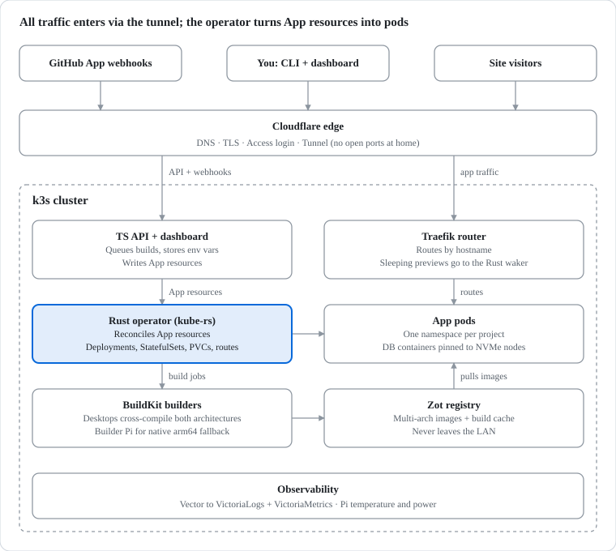
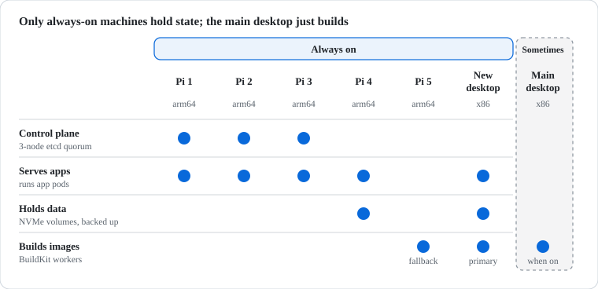
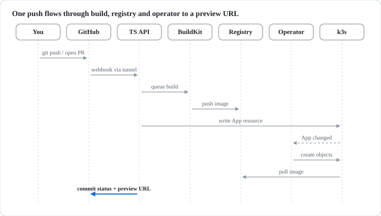
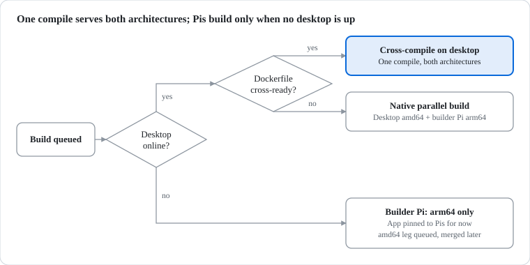
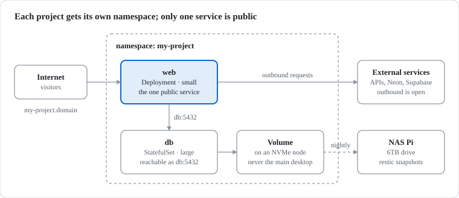
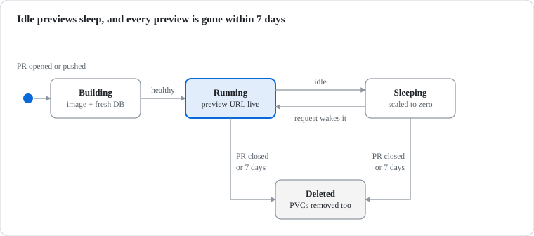
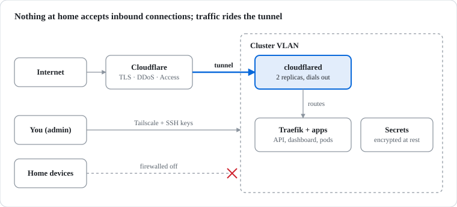
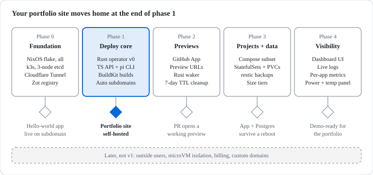

# Phoenix Firefly

> **Push a Dockerfile, get a live HTTPS app.** A self-hosted platform-as-a-service running on a stack of Raspberry Pis and two desktops in my home.

   
 

Phoenix Firefly hosts small web projects cheaply and quickly, like Heroku or Vercel, but on hardware I own. Today it's just for my personal projects. It's designed so I can later open it to people who find me through my portfolio.

---

## Single-Pi workflow

The current Pi uses NixOS, k3s and Tailscale. The platform described in the remaining sections is the target architecture.

### Wi-Fi secret

`nix/secrets.yaml` is encrypted for the admin age key and the Pi's SSH host key. Back up `~/.config/sops/age/keys.txt` in your password manager; never commit it. Edit the credential with:

```bash
cd nix
SOPS_AGE_KEY_FILE="$HOME/.config/sops/age/keys.txt" sops secrets.yaml
```

Keep the `wireless_env` value in the form `psk_home=<password>`. The Pi decrypts it to `/run/secrets/wireless_env`; Nix only stores ciphertext.

Run `nix/deploy.sh` from the Mac to copy tracked Nix files and switch the Pi. Stage new Nix files first. The rebuild runs as a systemd service, and the script reconnects after Wi-Fi interruptions to read its exit status. It waits up to 30 minutes and prints the unit name if it times out; the rebuild can still be running.

Use Ethernet for the first secret migration. After verifying Wi-Fi, retire old Nix generations, the old SD image and the old `firefly-nix` container from the implementation plan. Those older copies still contain the plaintext credential. The script does not delete them or stale remote files such as `~/nix/wifi.nix`.

A freshly flashed card needs Ethernet until its new SSH host key is added as a recipient. Convert the authenticated host public key with `ssh-to-age`, update `&firefly-pi` in `nix/.sops.yaml`, then run `sops --config nix/.sops.yaml updatekeys nix/secrets.yaml` from the repo root and redeploy.

### Landing image

With Docker Desktop running and SSH access to `firefly-pi.local`:

```bash
deploy/ship.sh landing frontend deploy/landing.yaml
```

The script builds an arm64 image, imports it into the Pi's containerd, applies the manifest and waits for rollout. Each invocation restarts the deployment, including unchanged tags. Dirty frontend builds get a timestamp suffix. The landing page is available over Tailscale at `http://landing.100.79.119.115.nip.io`; the bare Pi IP still routes to whoami.

Images stay on this one node, and k3s can garbage-collect them under disk pressure. A second node needs a registry. These scripts do not configure Cloudflare or HTTPS.

Run the script regression checks with `node --test deploy/scripts.test.mjs`. Frontend HTTP tests need a running app; set `TEST_URL` if it does not use port 3000.

## At a glance

| **What you deploy**    | Static sites, single-container apps, and multi-container projects (including their own Postgres/Redis containers) |
| ---------------------- | ----------------------------------------------------------------------------------------------------------------- |
| **How you deploy**     | `git push`, the `pi` CLI, or the web dashboard                                                                    |
| **What you get**       | `myapp.<domain>` over HTTPS, plus a preview URL for every pull request                                            |
| **What it runs on**    | 5× Raspberry Pi 5 (8GB) + an always-on desktop + a gaming desktop that pitches in when it's free                  |
| **Open ports at home** | **Zero.** All traffic arrives through a Cloudflare Tunnel                                                         |

---

## How it works

Every request comes in through Cloudflare. Every deploy, no matter where it starts, becomes an `App` resource that a Rust operator turns into running containers.



---

## The hardware

Each machine gets the job that fits how reliably it stays on. **Nothing that holds data or votes on cluster state runs on a machine that might switch off.**



| Node | Arch | Job | Serves apps? |
|---|---|---|:---:|
| Pi 1–3 | arm64 | Control plane (3-node etcd, survives one failure) + light apps | ✅ |
| Pi 4 | arm64 | Worker with NVMe for database containers | ✅ |
| Pi 5 | arm64 | Dedicated native arm64 builder | ❌ |
| New desktop | x86 | Heavy worker, main builder, image registry, databases | ✅ |
| Main desktop | x86 | Extra build power when booted into NixOS | ❌ |

The whole cluster is defined in **one NixOS flake**. Every node can be rebuilt from scratch with one command.

---

## Deploying an app

Three front doors, one path. They all end with the API writing an `App` resource.



```bash
# or skip GitHub entirely
cd my-project
pi deploy            # uploads source, streams build logs, prints the URL
pi logs my-project -f
pi env set API_KEY=...
```

---

## Building once for two CPU architectures

The Pis are ARM and the desktops are x86. Instead of building every app twice (or slowly emulating ARM), the desktop **cross-compiles once** for both.



`pi init` writes a Dockerfile template that already follows the fast pattern, so the highlighted path is the default.

---

## Multi-container projects

Projects can bring their own database. Describe the services in a compose-style file you can also run locally:

```yaml
# pi.compose.yml
services:
  web:
    build: ./Dockerfile
    ports: ["3000"]        # the one public service
    environment:
      DATABASE_URL: postgres://app@db:5432/app
    depends_on: [db]
    tier: small
  db:
    image: postgres:17
    volumes: [pgdata:/var/lib/postgresql/data]
    tier: large
volumes:
  pgdata:
```



- Each project gets its **own namespace**. Other projects can't reach in.
- Services with volumes land only on **NVMe-backed nodes** and are backed up nightly to the NAS.
- Outbound internet is open, so external databases always work too.

### Size tiers

| Tier | Memory | CPU | Good for |
|---|---:|---:|---|
| 🟢 nano | 128 MB | 0.1 | Static sites, tiny APIs |
| 🟡 small | 512 MB | 0.5 | Node/Python apps, Redis |
| 🔴 large | 2 GB | 1.0 | Postgres, heavier apps |

---

## Preview deployments

Every pull request gets its own URL and its own fresh database. Idle previews sleep so they don't eat Pi memory.



---

## Security model



- **No open ports.** The home IP stays hidden behind Cloudflare.
- **Dashboard and API** sit behind Cloudflare Access (GitHub login). The only exception is the GitHub webhook, which is verified by its signature.
- **Secrets** are stored as Kubernetes Secrets, encrypted at rest. They're set through the CLI or dashboard and never baked into images.

---

## Observability

| Signal | Tooling | Where you see it |
|---|---|---|
| 📜 Logs | Vector → VictoriaLogs | `pi logs -f`, dashboard tail |
| 📈 Metrics | VictoriaMetrics + kube-state-metrics | Per-app usage vs. tier limit |
| 🌡️ Node health | `vcgencmd`, smart plug | Pi temps, throttling, cluster wattage and cost |

---

## Roadmap



---

## Repository layout (planned)

```
pipaas/
├── nix/          # flake: every node's OS, k3s, secrets keys
├── operator/     # Rust · kube-rs controller for the App resource
├── waker/        # Rust · wakes sleeping previews on request
├── builder/      # Rust · build routing (cross-compile / fallback / deferred)
├── api/          # TypeScript · REST API + GitHub App webhooks
├── dashboard/    # TypeScript · web UI
├── cli/          # TypeScript · the `pi` command
└── templates/    # cross-compile Dockerfiles per stack
```

---

## Why build this?

- **Cheap.** Hardware I already own, and the Pis sip power.
- **Fast.** One push to a live URL, with previews on every PR.
- **Learning.** A real Kubernetes operator in Rust, a multi-arch build system, and a cluster defined in NixOS.
