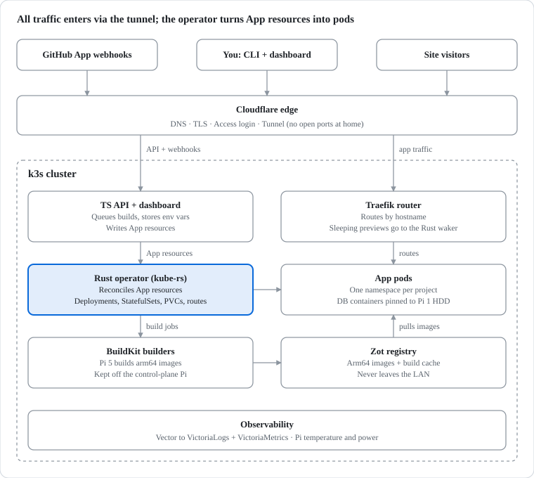
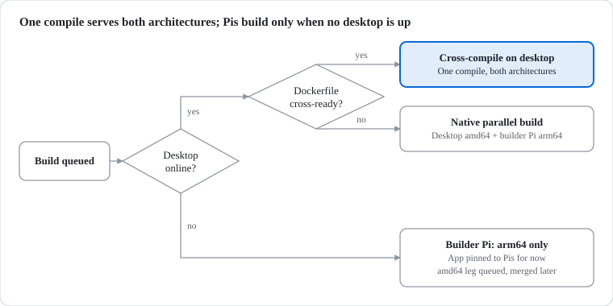
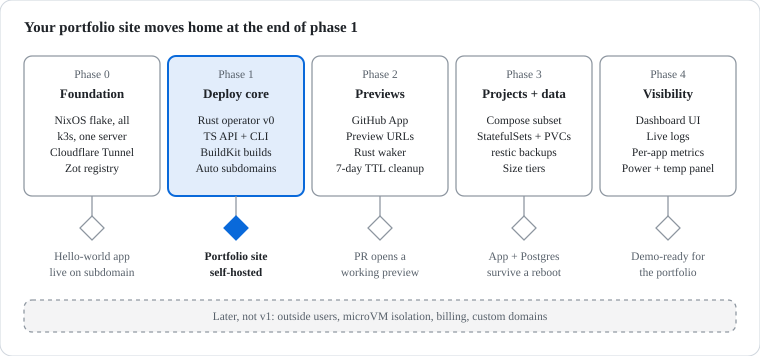

# Architecture

## Overview

Phoenix Firefly is a self-hosted PaaS on five Raspberry Pi 5s. It turns a Dockerfile repo into a live HTTPS app with one push. v1 hosts only Cameron's own projects. Invited users come in v1.5, after the hardening gate below. An always-on desktop can join later.

**Goals**

- Deploy a personal project in under a minute from `git push`, the CLI or the dashboard
- Give each Pi one clear job: Pi #1 runs the platform, Pis #2 to #4 serve apps, and Pi #5 builds
- Be a strong portfolio piece: a Rust Kubernetes operator, a TS control plane, and a NixOS-defined cluster

**v1 scope:** static sites, single-container apps and multi-container projects (compose-style, including their own database containers), auto subdomains, per-branch previews.

**Non-goals for v1:** outside users, billing, microVM isolation, managed databases, custom domains, scale-to-zero for production apps, multi-arch builds.

## Hardware roles

The design fits the hardware on hand: five 8GB Pi 5s on SD cards, one Ethernet cable, Wi-Fi, a consumer router and two 1TB USB hard drives. No always-on desktop is available yet, so the control plane stays on a Pi. The README's "Single-Pi workflow" covers what runs today.

| Node | Arch | Role | k3s labels / taints | Serves apps? |
| --- | --- | --- | --- | --- |
| Pi #1 (`firefly-pi`) | arm64 | Only k3s server (SQLite, no etcd), the Ethernet cable, `cloudflared`, Zot registry, all volumes on HDD 1, backups on HDD 2 | `role=control`, `storage=hdd` | Stateful services only |
| Pi #2 to #4 | arm64 | Stateless k3s agents over Wi-Fi | `serve=true` | Yes |
| Pi #5 | arm64 | Dedicated native builder | `role=builder`, taint `builder:NoSchedule` | No |

- **Storage:** SD cards hold the OS only. The k3s data directory, the registry and every volume go on HDD 1.
- **Failure:** Pi #1 is a single point of failure. If it or HDD 1 dies, the platform is down until it is rebuilt and restored from HDD 2. That is acceptable for an owner-only v1.
- **Memory:** the single node used 2.3GB of 8GB with almost nothing deployed. Plan on about 4.5GB for workloads on Pi #1 (an estimate), which fits one large database and one small service.
- **Network:** a small switch and cables (an estimated $25 to $35) would make the agents sturdier, but the design does not depend on them.
- **Page size:** the Pi 5 kernel uses 16K pages. Some arm64 binaries whose jemalloc was built for 4K pages abort at start, so images must be tested on the cluster. The `linux_rpi4` (bcm2711) kernel is in the nixos-raspberrypi binary cache and is the candidate 4K option. It has not been boot-tested on a Pi 5.

**When an always-on desktop joins**, it takes the Ethernet cable and becomes the only k3s server, with the registry, volumes, `cloudflared` and backup drive. Every Pi then becomes a stateless agent, and a 16GB desktop could hold roughly five large databases (an estimate). It runs only pulled multi-arch images, such as Postgres and Redis, until multi-arch builds exist. The 9800X3D desktop stays outside the cluster because it goes offline unpredictably.

## Architecture

k3s does scheduling. Cameron's code is the PaaS layer on top: a TS API, dashboard and CLI that write `App` resources, and a Rust operator that turns them into running workloads.

The operator is the heart of the system: every front door converges on an `App` resource, and the operator creates the Kubernetes objects, then deploys onto app pods. k3s components (Traefik, CoreDNS, local-path provisioner) are used as bundled; ServiceLB stays enabled because the tunnel reaches Traefik through it at `localhost:80`.

## Build pipeline

Pi #5 builds every image natively for arm64. App builds run arbitrary code, so they stay off Pi #1, which holds the control plane, databases and tunnel credentials.

- **Builder:** BuildKit runs in k3s through the buildx Kubernetes driver, pinned to `role=builder`.
- **Cache:** `--cache-to/--cache-from type=registry` against the Zot registry on Pi #1, so the cache avoids Pi #5's SD card and images never leave the LAN.
- **Template:** `firefly init` writes a Dockerfile template per stack (static, Node, Python, Rust).

**Deferred: multi-arch builds.** No amd64 node serves apps yet, so a second architecture adds work without a use. The target below returns when an always-on desktop joins.

## Apps, services and storage

A project is one `App` custom resource holding one or more services. Multi-container projects with their own database containers are supported. A project config file declares them, a subset of `docker-compose.yml`, so local dev and production match.

**How the Rust operator maps a project**

- Project → its own namespace, with a NetworkPolicy that blocks traffic from other projects; outbound internet allowed
- Stateless service → Deployment + Service
- Service with a volume (e.g. `postgres`) → StatefulSet + local-path PVC, scheduled only on `storage=hdd`, which is Pi #1
- Exactly one service is marked `public` → gets the subdomain route; others are reachable only inside the namespace by service name (`db:5432`)
- External databases (Neon, Supabase, etc.) always work, since outbound internet is open

**Supported compose subset (v1):** `build` (Dockerfile path), `image`, `environment`, `env_file`, `ports` (only to mark the public port), `volumes` (named volumes only), `depends_on` (start order), `healthcheck`. Anything else fails validation with a clear error rather than being silently ignored.

**Backups:** a nightly restic job snapshots every PVC and the k3s datastore to HDD 2. Databases get a pre-backup dump hook (`pg_dump`, `redis-cli SAVE`) so snapshots are consistent. Both drives sit in the same house, so there is no offsite copy.

**Size tiers.** Memory requests equal limits, so the scheduler packs predictably. CPU is a request with no limit, so a Node app can burst through its cold start.

| Tier | Memory | CPU request | Typical use |
| --- | --- | --- | --- |
| nano | 128MB | 0.1 | Static sites, tiny APIs |
| small | 512MB | 0.5 | Node/Python apps, Redis |
| large | 2GB | 1.0 | Postgres, heavier apps |

Tiers are set per service. A project's total is the sum, which maps cleanly to pricing if the platform opens up later.

## Deploy flows and previews

Three front doors, one backend. The git push, CLI and dashboard paths all end in the TS API writing an `App` resource. The operator does the rest, so no path has special behavior.

1. **git push:** a GitHub App sends push and pull-request webhooks through the Cloudflare Tunnel to the API. The API queues a build and posts a commit status plus the preview URL back to the PR.
2. **CLI:** `firefly deploy` from a project folder uploads the source tarball (no GitHub required), streams build logs, and prints the URL. It's scriptable, so coding agents can drive it.
3. **Dashboard:** the same API calls with a UI for status, logs, env vars, tiers and redeploys.

**CLI commands.** The CLI ships on its own for macOS and Linux, installed as `firefly` with a short `pf` alias. `dj pf deploy` can hand off to it.

| Command | What it does |
| --- | --- |
| `firefly login` | Sign in through the browser |
| `firefly init` | Create the project config, detect the framework and write a Dockerfile template |
| `firefly projects list`, `create` | Manage projects |
| `firefly upload` | Upload static assets or a bundle |
| `firefly deploy` | Upload source, stream build logs and print the URL |
| `firefly preview` | Deploy a branch or PR and print its preview URL |
| `firefly logs <app> -f` | Follow app logs |
| `firefly analytics` | Show requests, latency and errors per host |
| `firefly env list`, `set`, `unset` | Manage env vars for production and previews |
| `firefly status` | Show the last deployment, URL and image tag |
| `firefly whoami` | Show the signed-in user |
| `firefly doctor` | Check local tools and whether the API is reachable |

**URLs**

- Production: `<app>.diamondjdev.me` through a wildcard DNS record on the tunnel
- Previews: `<app>-pr-<n>.diamondjdev.me`, or `<app>-<branch>.diamondjdev.me` for CLI deploys
- Hostnames stay one label deep: the free Universal SSL certificate covers `*.diamondjdev.me` only
- Cloudflare terminates TLS at the edge; inside the cluster, Traefik (bundled with k3s) routes by hostname

**Preview lifecycle**

- Created on PR open or push; gets fresh copies of any database services (empty or seeded), never production data
- Sleeps after an idle window: the whole project scales to zero together, so an app never wakes without its database
- Wakes on request: a small Rust "waker" in front of sleeping hostnames holds the request, scales the project up, and forwards when it's healthy
- Deleted when the PR closes, or after a **hard 7-day time-to-live**, whichever comes first (PVCs included)

## Security, secrets and observability

The home network is never exposed directly: no open ports, and the home IP stays hidden behind Cloudflare.

**Network**

- `cloudflared` runs as a NixOS service on Pi #1 and only dials out
- The consumer router has no cluster VLAN, so pods share the home LAN. That is acceptable only while every workload is Cameron's own
- Admin access to nodes over Tailscale; SSH keys only, defined in the NixOS flake

**Access:** the dashboard and API sit behind Cloudflare Access (GitHub login, allow-list of 1). The webhook endpoint is the only bypass, verified by the GitHub App's webhook signature. The CLI authenticates with a Cloudflare Access service token.

**Secrets:** stored as Kubernetes Secrets with k3s `--secrets-encryption` enabled. k3s generates the encryption key on the server, so it never enters git. Env vars are set through the CLI and dashboard and are never baked into images.

**Observability**

- Logs: Vector on every node → VictoriaLogs; `firefly logs <app> -f` and a live dashboard tail
- Metrics: VictoriaMetrics + kube-state-metrics + node-exporter; per-app CPU/RAM vs tier limit in the dashboard
- Node health: Pi SoC temperature and throttling from `vcgencmd`; wattage via a smart plug. Shown as a cluster power and cost panel
- VictoriaMetrics/Logs chosen over Prometheus/Loki for a much lighter footprint on Pis

**v1.5 gate.** No invited user gets access until all of this is in place (details in `docs/feedback-resolutions.md`, batch 6):

- `hostUsers: false`, Pod Security `baseline`, no service-account token, and a ResourceQuota per tenant namespace
- Egress rules that block private ranges, enforced by NetworkPolicy and node firewalls
- Registry auth, and Access JWT verification in the API
- Reserved hostnames, an owner suffix on tenant apps, and `__Host-` cookies on Cameron's own apps
- A written answer on whether the ISP terms allow this traffic

## Decision log

Decided 2 Nov 2026, revised 18 Nov 2026 to fit the hardware on hand. Revisit any row by changing it here.

| Area | Decision | Main alternative rejected | Why |
| --- | --- | --- | --- |
| Tenants | Just Cameron in v1; invited users in v1.5 after the hardening gate | Invited users in v1 | Keeps isolation, abuse handling and identity out of the first release |
| Control plane | One k3s server on Pi #1 with SQLite | Three-node etcd | etcd would be unstable on Wi-Fi and SD cards |
| Workloads | Static sites + containers + multi-container projects | Managed databases | Compose-style DB containers cover the need with far less to build |
| Goal | Learning + portfolio | Off-the-shelf (Coolify) | Building the operator is the point |
| Ingress | Cloudflare Tunnel | VPS edge + WireGuard | No open ports, hidden IP, free DDoS protection |
| Orchestration | k3s + custom PaaS layer | Custom scheduler | Kubernetes skills on the resume; effort goes into the PaaS layer |
| Node OS | NixOS everywhere, one flake | Pi OS + Ansible | Reproducible; already uses flakes |
| Languages | TS for API/dashboard/CLI; Rust for operator, waker, build orchestration | Go | Plays to TS strength; Rust where speed and correctness matter |
| Images | Dockerfile required | Railpack/Nixpacks | One predictable path; agents write Dockerfiles anyway |
| Build arch | Native arm64 on Pi #5; multi-arch deferred | Cross-compile now | No amd64 node serves apps yet |
| Main desktop | Outside the cluster | Opportunistic builder | Goes offline unpredictably, and multi-arch builds are deferred |
| URLs | Auto subdomains + per-branch previews | Custom domains | Custom domains deferred past v1 |
| Previews | Sleep when idle; delete on PR close; 7-day hard TTL | Always on | Keeps Pi RAM free |
| Deploy | git push (GitHub App), CLI, dashboard | GitHub Actions | Direct webhooks are faster and post status to PRs |
| Secrets | k8s Secrets + encryption at rest | Vault/OpenBao | Too heavy for Pis |
| Access | Cloudflare Access | Custom auth | No auth code in v1 |
| Limits | Size tiers (nano/small/large) | Custom per app | Predictable packing; maps to pricing later |
| Storage | local-path PVCs on HDD 1 + nightly restic to HDD 2 | Longhorn | Replicated storage is too heavy for Pis on Wi-Fi |

## Roadmap and open questions

Five phases, each ending in a gate you can demo. Phase 1 is the first real payoff: your own portfolio site served from the cluster.

A phase isn't done until its gate passes on real hardware, including after a node reboot.

**Open questions**

- [x] Names: the platform is Phoenix Firefly, and the CLI is `firefly` with a `pf` alias
- [x] Platform domain: `*.diamondjdev.me`
- [x] NixOS on Pi 5: boots through nixos-raspberrypi
- [ ] When can an always-on desktop join, and how much RAM will it have?
- [ ] Can Pi #1 power both USB drives, or do they need a powered hub?
- [ ] Page size: do the images we rely on run on 16K pages, and does the bcm2711 kernel boot on a Pi 5?
- [ ] Seeding preview databases: empty, a seed script in the repo, or a sanitized snapshot
- [ ] Does your ISP plan allow hosting? The tunnel avoids open ports, but check the terms of service before opening to outside users
